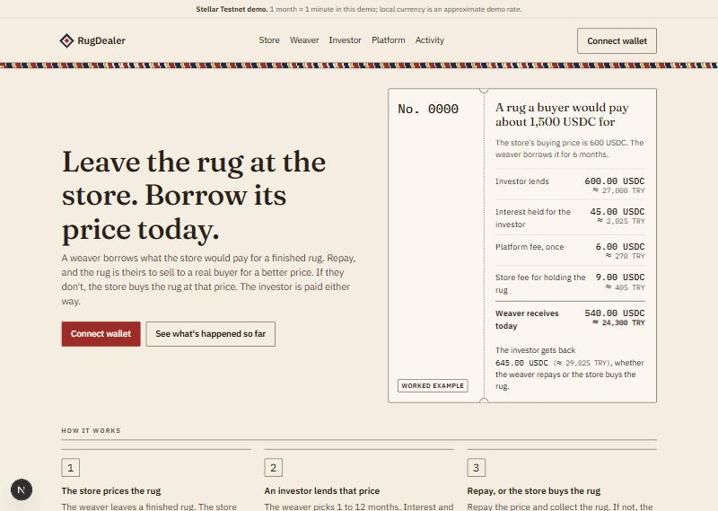

# RugDealer

Weavers can borrow against a finished rug instead of selling it cheaply. This is a working prototype on Stellar Testnet: a Soroban contract and a web app with one desk for each role.

**Live app:** [rugdealer.vercel.app](https://rugdealer.vercel.app)
**Contract on Stellar Testnet:** [`CCX3Z3DJ…4M2J`](https://stellar.expert/explorer/testnet/contract/CCX3Z3DJ7KS6YCSWQCIOJWFZCB76A7SD7LJI6BHDILO5FGSI6ZJJ4M2J)



This project addresses the challenge's **Problem Space 1: Access to Fair Financial Assets and Affordable Financing**.

## The problem

A weaver often needs cash the day a rug comes off the loom. A real buyer may pay well for it, but finding that buyer takes months. Meanwhile the local rug store will buy it today for about 40% of that price. Weavers who need the money take the low offer, and the store keeps the profit.

## How it works

1. **The store prices the rug.** The weaver leaves a finished rug at a rug store. The store offers its normal buying price. If the weaver accepts, the store issues a rug certificate at that price and keeps the rug safe.
2. **An investor lends that price.** The weaver asks to borrow exactly the certificate's price for 1 to 12 months. An investor funds the whole loan in USDC. Interest and fees come off the top, once, and the weaver receives the rest straight away.
3. **Repay, or the store buys the rug.**
   - **Weaver repays.** The weaver pays back the loan amount, collects the rug and can sell it to a real buyer whenever one turns up.
   - **Weaver doesn't repay.** The store must buy the rug at the same price within its buy-out window (60 seconds in this demo; 7 days planned), and the investor is paid from that.
   - **Weaver repays late.** Until a store buy-out or investor claim confirms, the weaver can still repay.
   - **The store misses its buy-out too.** The store is frozen, and the investor takes the rug and the interest instead of the loan amount.

When the weaver repays or the store buys, the investor receives the loan amount plus interest, or an equal backed credit if wallet delivery fails. The rule keeps the price honest. The store won't overprice, because it may have to pay that price. It won't underprice much either, because the weaver can take the rug to another store. That only works when the store and the weaver are different people, so the contract refuses a store as a borrower and refuses anyone as investor on a loan they're part of.

### Worked example

A real buyer would pay about $1,500 for the rug. The store's buying price is $600, and the weaver borrows it for 6 months.

| | Amount |
|---|---:|
| Investor lends | $600 |
| Interest held for the investor (15% a year, 6 months) | $45 |
| Platform fee (1%, once) | $6 |
| Store fee for holding the rug (0.25% a month) | $9 |
| **Weaver receives up front** | **$540** |

| How it ends | Weaver | Store | Investor |
|---|---|---|---|
| Weaver repays | Pays $600, gets the rug back. Total cost $60 | Earned $9 | Gets $645 |
| Weaver doesn't repay | Owes nothing more and keeps the $540 | Pays $600 and owns the rug | Gets $645 |
| Store also misses its 7-day buy-out | Owes nothing more | Frozen: can't issue new certificates | Takes the rug and the $45 interest |

## Who holds what

| Who | What they do | What they hold |
|---|---|---|
| Weaver | Leaves the rug, borrows its price, repays to get it back | The rug certificate, when no loan is open |
| Rug store | Prices the rug, issues the certificate, stores the rug, buys it if the loan isn't repaid | The physical rug |
| Investor | Funds one whole loan | Nothing during the loan |
| Soroban contract | Locks the certificate, pays out the loan, holds the interest, collects the repayment or buy-out, pays the investor | The locked certificate and the interest |
| Platform | Approves stores, sets each store's limit, freezes stores that break the rules, takes the 1% fee | Nothing. It can't move money or certificates |
| Converter (mocked) | A Stellar anchor that would swap USDC and local currency | Nothing |

## What runs on Stellar

- **One Soroban contract** ([`contracts/rugdealer`](contracts/rugdealer)) does the following:
  - records stores, rug certificates and loans
  - moves test USDC
  - enforces the settlement windows: store buy-out on `[end, end + window)`, investor claim from `end + window`
  - always lets a loan close: if the investor's wallet can't take a payout, the contract holds it for them to withdraw later
  - emits an event for every action
- **Rug certificates** are records inside the contract, each with an id, store, description, price, owner and status. There is no separate Stellar asset or trustline per rug.
- **Rug pictures** are woven patterns the app generates from each certificate number, so certificates are easy to tell apart. They are not photos of the real rugs: the contract stores only a text description. A real version would photograph each rug at intake and record the photo's fingerprint on the certificate.
- **USDC** is a test asset with its own Stellar Asset Contract. The weaver's local currency is mocked at a fixed demo rate of 1 USDC ≈ 45 TRY.
- **The web app** ([`frontend/`](frontend)) does the following:
  - signs with Varial
  - simulates every transaction before sending it, so archived contract data is restored automatically
  - builds the activity feed from contract events

The full API is in [`docs/contract-interface.md`](docs/contract-interface.md), and the rules are in [`docs/mechanism-guide.md`](docs/mechanism-guide.md).

## Try it

The app has five pages: **Store**, **Weaver**, **Investor**, **Platform** and **Activity**.

**Without a wallet.** Open any desk and choose **Look around as …** to see that demo account's screen read-only. The Activity page shows everything that has happened on the contract in plain sentences.

**With a wallet.**

1. Install the [Varial](https://www.freighter.app/) wallet (formerly Freighter) in Chrome and switch it to **Testnet**.
2. Import a demo account, or create a new one and fund it with test XLM from [Friendbot](https://friendbot.stellar.org).
3. A new account also needs test USDC. Press **Add USDC to wallet** on the wallet chip to add the trustline. The test USDC issuer then has to send you some, because the app can't mint it.
4. Then follow one rug from start to finish:

| Step | Desk and account | Button |
|---|---|---|
| 1 | Store (Kaya Rug House) | **Issue rug certificate** for Ayşe the weaver |
| 2 | Weaver (Ayşe the weaver) | Pick a length → **Ask for 600.00 USDC** |
| 3 | Investor (Deniz the investor) | **Lend 600.00 USDC** |
| 4a | Weaver | **Repay 600.00 USDC**, then **Collect the rug** and send the link to the store |
| 4b | Store, once the loan is overdue | **Buy the rug for 600.00 USDC** |
| 4c | Investor, once the store's window has closed | **Take the rug** |
| 5 | Store | Open the weaver's link → **Sign to close the certificate**, then hand the rug over once it's confirmed |

In this demo deployment, **1 loan month is 60 seconds** and the store's buy-out window is also 60 seconds. A whole loan therefore plays out in a few minutes.

## Testnet deployment

| Item | Value |
|---|---|
| Network | Stellar Testnet |
| RugDealer contract | `CCX3Z3DJ7KS6YCSWQCIOJWFZCB76A7SD7LJI6BHDILO5FGSI6ZJJ4M2J` |
| Test USDC (contract) | `CCKKWM4ROXHPJAALYDXWL676MUB6OKGSWAZUOTB5SJIBWQ3B5ZDQZ3OM` |
| Test USDC (asset) | `USDC:GAWNPX6FZB7B7TZP6WC2H6L7AOYRXPBRDBWPISSAIFQPZX7GAQO3TWRY` |

Deployment parameters:

| Parameter | Value |
|---|---|
| Interest | 1,500 bps a year |
| Platform fee | 100 bps, once |
| Store fee | 25 bps a month |
| Longest loan | 12 months |
| Loan month | 60 s |
| Buy-out window | 60 s |
| Store limit | 5,000 USDC each |

In a real deployment, a month would be 30 days and the window 7 days. Both are constructor parameters.

Demo accounts (public keys only):

| Name in the app | Role | Public key |
|---|---|---|
| RugDealer platform | Platform admin and fee recipient | `GCXRZRWAXQ2HDXIUAC5BZRZOLMD3RGLU42K64VHWCQV57CGXJWQTVCIZ` |
| Kaya Rug House | Store | `GBWCNPACZXNZKJKB7NA2EHRCZTNWT3LQBEHTYPTVF5X6VZNU5RXPPLCN` |
| Bazaar Corner Rugs | Store, frozen after the missed-buy-out demo | `GDWBZD65XOYVVDMQHOST5SEQH4ZBXZTADY3NJIOGMYSYYVGK5RAFZ5RQ` |
| Ayşe the weaver | Weaver | `GBH4TKU2HPW7PGY5BCDU73E3PMZUK7TQ7RVDHP5QDTK23BHKW2XDGOQF` |
| Deniz the investor | Investor | `GCVBINDMVFUMQ3OBUVQGE6RFBWWBHSRKSLEQVZ6I7XQNQR2424HQOA2W` |

Transaction hashes for the deployment and the three scripted scenarios are in [`docs/testnet-deployment.json`](docs/testnet-deployment.json) and [`docs/testnet-demo-results.json`](docs/testnet-demo-results.json).

## Run it locally

You need Node 20 or later and npm.

```bash
cd frontend
npm install
npm run dev
```

Open `http://localhost:3000`. The app is all client-side and talks straight to the public testnet RPC, so it needs no environment variables.

```bash
npm test           # local tests, including mounted wallet/custody/recovery flows
npm run smoke      # read-only checks against the live testnet contract
npm run typecheck
npm run build
```

The contract has its own tests:

```bash
cargo test
```

To deploy a fresh contract and run the scripted repay, buy-out and claim scenarios, see [`docs/testnet-demo.md`](docs/testnet-demo.md). This requires Python 3.10+ and the Stellar CLI. Secret keys stay in `~/.rugdealer-demo/config`, outside the repository.

### Deploying the web app

The live app is deployed from `frontend/` with the Vercel CLI:

```bash
cd frontend
npx vercel deploy --prod
```

To deploy from GitHub instead, import the repository on Vercel and set **Root Directory** to `frontend`. Next.js is detected automatically, and no environment variables are needed. After a contract redeploy, use the new public deployment manifest and rebuild the web app. `npm run dev`, `test`, `smoke`, `typecheck` and `build` generate the web configuration from `docs/testnet-deployment.json` (or the absolute path in `RUGDEALER_MANIFEST`). The explicit `npm run sync-deployment` command remains available. Do not edit generated `frontend/lib/deployment.json`; commit it alongside the selected public manifest when publishing a new default deployment.

The manifest must include **contract ID, deployment ledger, USDC SAC ID, asset code and issuer, and all six demo accounts** (admin/fee recipient, issuer, store, store2, weaver, investor). The generator checks the issuer/SAC relationship. The app uses Stellar Testnet's passphrase, RPC, Horizon, Friendbot and explorer URLs in `frontend/lib/deployment.ts`. A different contract needs a matching manifest at build time; changing only the contract ID is insufficient. See [fresh deployment setup](docs/testnet-demo.md#isolated-rehearsal-and-web-configuration).

## Repository layout

```text
contracts/rugdealer/   Soroban contract and its tests (Rust)
scripts/testnet.py     Testnet deploy and scripted demo scenarios
docs/                  Mechanism guide, contract interface, deployment records
frontend/              Next.js web app
  app/                 Landing, store, weaver, investor, platform, activity, rug timeline
  lib/                 Contract reads, transactions, wallet, events, money, rules
  test/, smoke/        Unit tests and live testnet smoke tests
```

## Limits of the prototype

The prototype leaves out the following:

- a real anchor (conversion to local currency is mocked)
- identity checks
- mainnet
- several investors on one loan
- trading rug certificates
- selling rugs through the contract

The partner agreement covers two cases outside the contract: a store that can't produce a rug, and a store that closes. Stellar network fees are paid by each signer, not sponsored by the platform. The testnet RPC keeps about 7 days of events, so older activity drops out of the feed. The contract state itself is kept.
